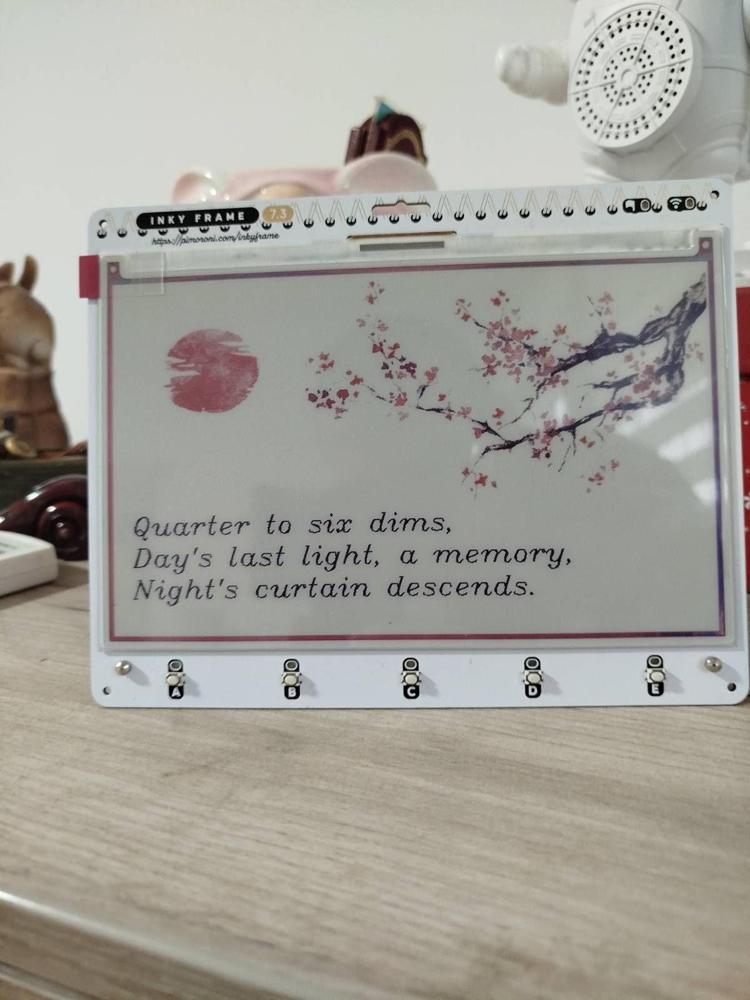
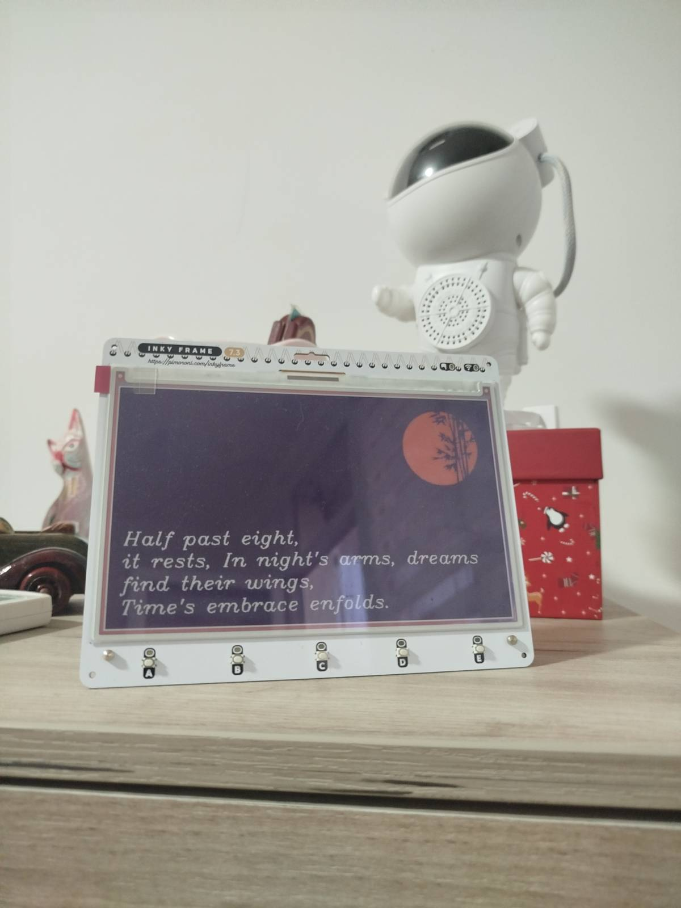

# Haiku Clock

A slow clock for the Pimoroni Inky Frame 7.3" e-paper display. Instead of showing digits, it tells the time with a haiku: every 15 minutes the frame wakes up, picks the haiku written for that moment of the day, draws it over a day or night background, and goes back to deep sleep. It runs for about three months on three AA batteries.

| Day mode (17:45) | Night mode (20:30) |
| :---: | :---: |
|  |  |

## How it works

On each wake-up, `main.py` runs once from top to bottom:

1. **Mount the SD card** – the haikus and background images live on the card, not in flash.
2. **Restore the time** – copies the time from the Inky Frame's battery-backed PCF85063A clock into the Pico's RTC.
3. **Sync if needed** – if the clock looks unset (year before 2026), it connects to Wi-Fi, tries a list of NTP servers until one answers, applies your timezone offset, and saves the result back to the hardware clock. After that, no Wi-Fi is needed.
4. **Pick the haiku** – rounds the current time down to the nearest quarter hour (`14:37` → `14:30`) and looks up the matching entry in `haiku.json`.
5. **Draw it** – from 06:00 to 19:59 it uses the day background with black text, otherwise the night background with white text. The text is laid out in the lower half of the screen, wrapping any line wider than the display.
6. **Sleep until the next quarter hour** – it calculates the minutes left until :00, :15, :30 or :45 and calls `inky_frame.sleep_for()`. In deep sleep the Pico and display are powered off and only the RTC chip stays on.

If the SD card can't be mounted, it sleeps for 15 minutes and tries again.

## Performance

| | |
| --- | --- |
| Wake-up to finished image | ~1 min 12 s (~40 s startup and JPEG decoding, ~32 s e-paper refresh) |
| Deep-sleep current | ~20 µA (RTC only) |
| Battery life | ~3 months on 3 × AA alkaline, refreshing every 15 minutes |

## Hardware

- [Pimoroni Inky Frame 7.3"](https://shop.pimoroni.com/products/inky-frame-7-3) (Raspberry Pi Pico W, 800×480 seven-colour ACeP e-paper)
- A microSD card
- 3 × AA batteries or USB power

## Project structure

| File | Purpose |
| --- | --- |
| `main.py` | Entry point: mount SD, sync time, choose and display the haiku, sleep |
| `display.py` | Draws the background JPEG and the haiku text (font, line splitting, wrapping, positioning) |
| `haiku_data.py` | Loads `haiku.json` from the SD card, finds the haiku for a given time, decides day vs night |
| `sync_time.py` | Wi-Fi connection, NTP sync with fallback servers, timezone offset |
| `sd_card.py` | Mounts the SD card over SPI at `/sd` |
| `secrets.py` | Wi-Fi credentials and timezone offset |
| `haiku.json` | The 96 haikus, one for every quarter hour of the day |
| `bg_day.jpg`, `bg_night.jpg` | Day and night backgrounds (800×480) |
| `dnevni_rezim.jpeg`, `nocni_rezim.jpeg` | Photos of the frame in day and night mode |

## The haikus

`haiku.json` holds one haiku for each quarter hour from `00:00` to `23:45`, and each one mentions its own time:

```json
{
  "haikus": [
    {"time": "00:00", "haiku": "Midnight, time's balance, Infinite stars align, Time's threshold, we cross."},
    {"time": "00:15", "haiku": "Quarter past midnight, Moon shares secrets with the stars, Night's realm, unbroken."}
  ]
}
```

Times use 24-hour `HH:MM`. If a time has no entry, only the background is shown.

**How lines are split:** `display.py` breaks the text at commas. The part before the first comma becomes line 1, the part after the last comma becomes line 3, and everything in between becomes line 2 (wrapped if it's too wide). A haiku with exactly two commas therefore shows as a clean three-line poem. A haiku with extra commas gets a longer middle line, as in the night photo above.

## Setup

1. **Flash the firmware.** Install Pimoroni's MicroPython build for Inky Frame, v1.26.1 (from the [pimoroni-pico releases](https://github.com/pimoroni/pimoroni-pico/releases)). It includes `inky_frame`, `picographics` and `jpegdec`.
2. **Configure `secrets.py`:**
   ```python
   WIFI_SSID = "your-network"
   WIFI_PASSWORD = "your-password"
   TIMEZONE_OFFSET = 1   # hours from UTC: 1 for CET (winter), 2 for CEST (summer)
   ```
3. **Copy the code** to the Pico (with [Thonny](https://thonny.org/) or `mpremote`): all the `.py` files, plus `sdcard.py` if your firmware doesn't already include it.
4. **Prepare the SD card.** Copy `haiku.json`, `bg_day.jpg` and `bg_night.jpg` to the root of the card and insert it.
5. **Reset or power the frame.** The first run syncs the time over Wi-Fi; after that it wakes every 15 minutes.

Debug messages are printed to the serial console, so connect with Thonny to watch what it's doing.

> **Tip:** Stop the program cleanly in Thonny before unplugging. Interrupting it while the SD card is being accessed can corrupt the card's file system. If that happens, reformat the card and copy the files back.

## Customisation

- **Backgrounds** – replace `bg_day.jpg` / `bg_night.jpg` with your own 800×480 baseline (non-progressive) JPEGs. Keep the lower half fairly plain, since that's where the text goes.
- **Day/night hours** – change the condition in `is_day()` in `haiku_data.py` (currently `5 < hour < 20`).
- **Font and size** – `graphics.set_font()`, `scale` and `set_thickness()` in `draw_haiku()` in `display.py`.
- **Text position** – `x`, `MAX_WIDTH` and the `start_y` calculation in `draw_haiku()`.
- **NTP servers** – the `ntp_servers` list in `sync_time.py`.

## Known limitations

- **No automatic daylight saving time.** The timezone offset is a fixed value in `secrets.py` and has to be changed by hand twice a year. Since the time is only synced when the clock is unset, the new offset takes effect only after the hardware clock is reset.
- **Needs internet on first start.** Until the first successful NTP sync, the clock doesn't know the real time and shows the wrong haiku.
- **Depends on the SD card.** A damaged card or a loose contact stops the clock from showing anything (it keeps retrying every 15 minutes).
- **Fixed, English-only content.** The 96 haikus were generated in advance with ChatGPT and are only in English. Changing them means taking out the SD card and editing the JSON on a computer.
- **Limited RAM.** The Pico W has 264 KB of SRAM, which caps how complex the work can be — large or high-resolution JPEGs may not fit in memory while decoding.
- **Third-party firmware.** The project relies on Pimoroni's MicroPython build (v1.26.1). If that branch stops being supported or its API changes, the code would need updating. The firmware is open source, so it can be maintained independently if needed.

## Ideas for future development

- **AI-generated haikus** – generate a fresh haiku on each refresh from a language model, based on the time, season or weather.
- **Web interface** – add, edit and delete haikus from a browser on the local network, without removing the SD card.
- **More languages** – one JSON file per language (Serbian, Japanese, Italian…), switched with the frame's five buttons (A for English, B for Serbian, and so on).
- **Automatic DST** – work out the correct offset from the date so the clock never needs manual adjustment.
- **Extra information** – temperature, weather forecast, the date, or the moon phase alongside the haiku.
- **Solar power** – a small solar panel with a LiPo battery to make the clock fully self-sufficient.

## About

Developed by Janko Štrkalj as a bachelor's thesis, *Development, design and implementation of a haiku clock based on e-paper technology using the Inky Frame 7.3 device* (Faculty of Engineering, University of Kragujevac, 2026; mentor: Dr Aleksandar Đorđević).
